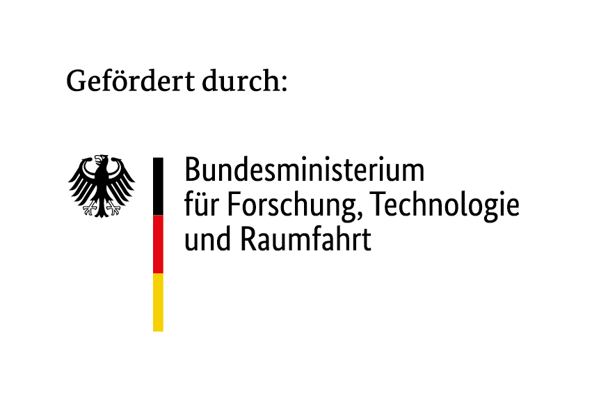
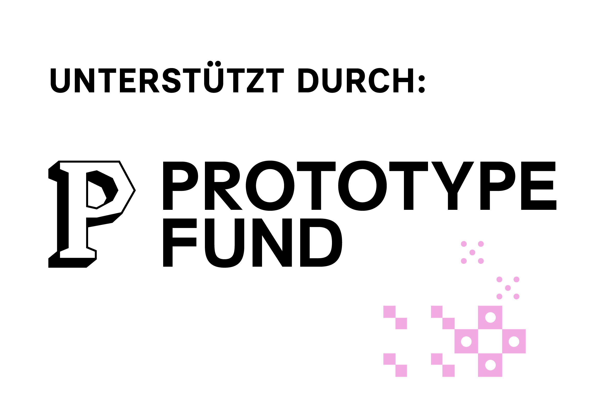

# openinvoicexml

[](https://github.com/HongbaeKim/openinvoicexml/actions/workflows/ci.yml)

> Deutsche Übersetzung von [README.md](README.md). Sie wird von Hand gepflegt und kann dem
> englischen Original hinterherhinken; im Zweifel gilt die englische Fassung.

Eine quelloffene TypeScript-Bibliothek zur Erzeugung konformer deutscher elektronischer Rechnungen
– XRechnung-UBL-XML, CII-XML und hybrides PDF/A-3 (einschließlich echtem Factur-X/ZUGFeRD in den
Profilen EN16931/XRechnung).

Ab 2028 müssen alle inländischen B2B-Rechnungen in Deutschland als strukturierte elektronische
Rechnungen ausgestellt werden. Diese Bibliothek deckt die gesamte Pipeline ab: strukturierte
JSON-Eingabe → validiertes XRechnung-XML → hybrides PDF mit eingebettetem XML.

Gefördert vom [Prototype Fund](https://www.prototypefund.de/projects/openinvoicexml)
(Juni–November 2026).

## Was die Bibliothek leistet

- Erzeugt XRechnung-3.x-konformes UBL-2.1-XML aus einer strukturierten JSON-Rechnung
- Validiert die Ausgabe mit KoSIT (dem offiziellen deutschen Validator für E-Rechnungen)
- Exportiert hybrides PDF/A-3b: `toHybridPdf()` bettet das XRechnung-UBL-XML als zugehörige Datei
  ein (mit veraPDF validiert); `toFacturXPdf()` bettet CII über `embedFacturX()` ein und erhebt
  damit einen echten Factur-X/ZUGFeRD-Konformitätsanspruch (Profile `EN16931`/`XRECHNUNG`, siehe
  [docs/LIMITATIONS.md](docs/LIMITATIONS.md) für die nicht unterstützten Profile
  MINIMUM/BASIC WL/BASIC); validiert mit KoSIT, veraPDF und Mustang
- `generateInvoiceDocument(invoice, { format })` bietet einen einzigen Aufrufpunkt für alle vier
  Ausgabeformate – XRechnung UBL, XRechnung CII, Factur-X/ZUGFeRD EN16931,
  Factur-X/ZUGFeRD XRechnung
- Läuft auch im Browser: `openinvoicexml/browser` erzeugt XRechnung-XML und PDFs lokal; externe
  Validatoren benötigen Java und laufen nur unter Node.js
- Deckt die wichtigsten deutschen Umsatzsteuer- und Rechtsszenarien ab: [§19][ustg-19]
  Kleinunternehmer, [§13b][ustg-13b] Steuerschuldnerschaft des Leistungsempfängers,
  innergemeinschaftliche Lieferungen, Gutschriften, Anzahlungsrechnungen und mehr – die vollständige
  Liste steht in [docs/SUPPORTED_SCENARIOS.de.md](docs/SUPPORTED_SCENARIOS.de.md)

## Status

Phase 4 (Hybrid-PDF/A-3-Export) abgeschlossen, als v0.4.0 getaggt – XRechnung-UBL-XML, CII-XML,
hybrides PDF/A-3 (UBL und echtes Factur-X/ZUGFeRD) und einheitliche Compliance-Diagnosen sind
implementiert und mit KoSIT, veraPDF und Mustang gegen alle Fixtures validiert (siehe
[docs/COMPLIANCE.md](docs/COMPLIANCE.md#validating-this-projects-output)). Phase 5
(Stabilisierung und Release-Vorbereitung) läuft; den vollständigen Plan finden Sie in
[docs/ROADMAP.md](docs/ROADMAP.md).

## Schnellstart

Voraussetzungen:

- Node.js 20+
- npm 10+

Installieren und Tests ausführen:

```bash
npm install
npm test
```

CI (`.github/workflows/ci.yml`) führt bei jedem Push und Pull Request auf `main` außerdem
`npm run lint` und `npm run typecheck` aus.

Eine Rechnung erzeugen (Node.js):

```ts
import { generateInvoice } from "openinvoicexml/adapters";

const { xml, issues } = generateInvoice(invoice); // invoice: siehe docs/DATA-MODEL.md

if (xml === null) {
  // issues enthält mindestens einen Eintrag mit severity: "error"
  for (const issue of issues) console.error(`${issue.code}: ${issue.message}`);
}
```

Im Browser:

```ts
import { generateInvoiceXml } from "openinvoicexml/browser";

const { xml, issues } = generateInvoiceXml(invoice);
```

Weitere Funktionen und Ausgabeformate: [docs/API.de.md](docs/API.de.md) (Überblick) und
[docs/API.md](docs/API.md) (vollständig, englisch).

## Projektstruktur

```
/core         — internes Rechnungsschema und Normalisierung
/adapters     — Ausgabe-Adapter (XRechnung-XML, CII, PDF/A-3)
/validators   — Validierungsschicht (Schema, KoSIT, veraPDF, Mustang)
  /rules      — einzelne Geschäftsregeln
/fixtures     — Beispielrechnungen und erwartete Ausgaben
/docs         — Architektur, Roadmap und API-Dokumentation
```

## Dokumentation

Die Dokumente sind auf Englisch. Deutsche Fassungen gibt es für diese Seite, die
[unterstützten Szenarien](docs/SUPPORTED_SCENARIOS.de.md) und einen [API-Überblick](docs/API.de.md).

| Dokument                                                | Inhalt                                                                |
| ------------------------------------------------------- | --------------------------------------------------------------------- |
| [`ARCHITECTURE.md`](docs/ARCHITECTURE.md)               | Adapter-Muster, Modulgrenzen, Datenfluss, Browser und Node.js         |
| [`DEVELOPMENT.md`](docs/DEVELOPMENT.md)                 | Lokale Einrichtung, Befehle, Abhängigkeiten, Konventionen             |
| [`COMPLIANCE.md`](docs/COMPLIANCE.md)                   | Compliance-Quellen, Regel-zu-Datei-Zuordnung, Validierung             |
| [`DATA-MODEL.md`](docs/DATA-MODEL.md)                   | Internes Rechnungsschema, Zuordnung der XRechnung-BT                  |
| [`API.md`](docs/API.md)                                 | API-Verwendung und Fehlercodes                                        |
| [`SUPPORTED_SCENARIOS.md`](docs/SUPPORTED_SCENARIOS.md) | Unterstützte, teilweise unterstützte und nicht unterstützte Szenarien |
| [`LIMITATIONS.md`](docs/LIMITATIONS.md)                 | Was nicht unterstützt oder nicht geprüft wird, und warum              |
| [`ROADMAP.md`](docs/ROADMAP.md)                         | Phasenziele, Nicht-Ziele, offene Fragen                               |
| [`SECURITY.md`](docs/SECURITY.md)                       | Sicherheitshinweise und verantwortungsvolle Offenlegung               |

## Begleit-Repository

Die gehostete Website, das Beta-/Entwickler-Anmelde-Backend und das Deploy-Tooling liegen in einem
eigenen Repository, [`openinvoicexml-web`](https://github.com/HongbaeKim/openinvoicexml-web), das
diese Engine nutzt und nicht umgekehrt.

## Lizenz

Apache-2.0

Optionale externe Validatoren (KoSIT, Mustangproject, veraPDF) sind eigenständige Projekte unter
eigenen Lizenzen und nicht enthalten – siehe
[docs/COMPLIANCE.md](docs/COMPLIANCE.md#third-party-validation-tools).

---

<p>
  
  
</p>

[ustg-13b]: https://www.gesetze-im-internet.de/ustg_1980/__13b.html
[ustg-19]: https://www.gesetze-im-internet.de/ustg_1980/__19.html
