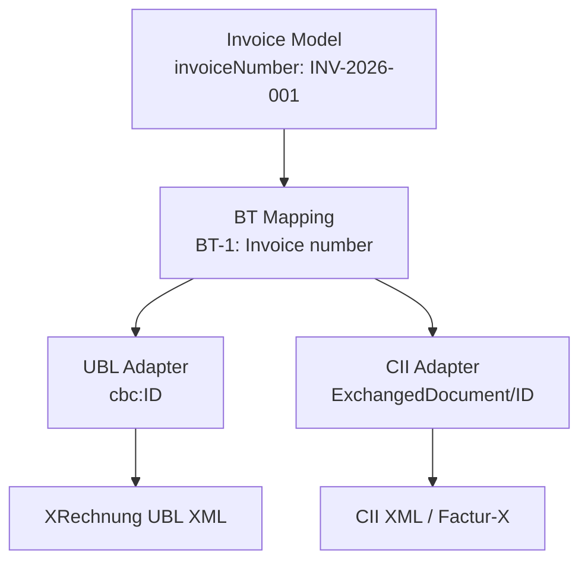

# Development Guide

Local setup, tooling, and how to propose changes for `openinvoicexml`.

---

## Local Setup

Prerequisites: Node.js ≥ 20.0.0, npm, git. The full path below also needs `curl`, `unzip`, `tar` and
`bash`; Java is optional, because the setup scripts download a portable JRE into `tools/jre/` when
no `java` is on your `PATH`.

There are two ways to set up, depending on what you are changing.

### Fast path: most changes

```bash
git clone https://github.com/HongbaeKim/openinvoicexml.git
cd openinvoicexml
npm install
npm test
```

This is enough for docs, types, schema, business rules and most adapter work. **A green fast-path
run does not mean the external validators ran.** Without KoSIT, veraPDF and Mustang installed, their
suites are skipped (not failed) when you run locally, and Vitest still counts them in the total in
brackets:

```
Tests  <passed> passed | <skipped> skipped (<total>)
```

Only "passed" with `0 skipped` means the validators ran. CI (or `OPENINVOICE_STRICT_VALIDATION=1`)
turns a missing validator into a failure instead of a skip.

The package-export test (`core/test/package-exports.test.ts`) imports the built package from `dist/`,
so on a fresh clone it is skipped too, with the reason in its name. Run `npm run build` before
`npm test` to include it, and rebuild after changing the source: an old `dist/` tests old code. CI
always builds first, and a missing `dist/` fails there.

### Full path: anything that touches XML or PDF generation

```bash
make kosit-setup && make verapdf-setup && make mustang-setup
npm test
```

This downloads the three external validators into `tools/` (one time) so the real KoSIT, veraPDF
and Mustang checks run against every fixture. Use it whenever you change the UBL, CII, Factur-X or
hybrid PDF adapters, the mapping, or a fixture.

On a 4-core machine (measured November 2026), the fast path takes about a minute and the full path
about ten, most of it the Mustang tests. Slower machines or networks take longer.

### Available Commands

| Command                        | What it does                                                                                                                                                                                                                                                                         |
| ------------------------------ | ------------------------------------------------------------------------------------------------------------------------------------------------------------------------------------------------------------------------------------------------------------------------------------ |
| `npm test`                     | Run all tests (Vitest)                                                                                                                                                                                                                                                               |
| `npx vitest list \| wc -l`     | Count the tests without running them                                                                                                                                                                                                                                                 |
| `npm run test:watch`           | Run tests in watch mode                                                                                                                                                                                                                                                              |
| `npm run test:coverage`        | Run tests with v8 coverage; fails if below the thresholds in `vitest.config.ts` (CI runs this instead of `npm test`)                                                                                                                                                                 |
| `npm run typecheck`            | Type-check without emitting files                                                                                                                                                                                                                                                    |
| `npm run lint`                 | Check for lint errors (ESLint)                                                                                                                                                                                                                                                       |
| `npm run lint:fix`             | Auto-fix lint errors                                                                                                                                                                                                                                                                 |
| `npm run format`               | Format all files (Prettier)                                                                                                                                                                                                                                                          |
| `npm run build`                | Compile TypeScript to `dist/`, then copy `adapters/assets/fonts/` into `dist/` (`tsc` only emits compiled `.js`/`.d.ts` — it doesn't copy binary assets, but `hybrid-pdf.ts` resolves its embedded fonts relative to its own compiled location, so they have to land in `dist/` too) |
| `make generate`                | Regenerate XML fixtures from `dist/` (run `npm run build` first)                                                                                                                                                                                                                     |
| `make kosit-setup`             | One-time download of the KoSIT validator + XRechnung config (see [`COMPLIANCE.md`](COMPLIANCE.md#validating-this-projects-output))                                                                                                                                                   |
| `make validate-kosit`          | Validate generated XML using KoSIT                                                                                                                                                                                                                                                   |
| `make generate-pdf`            | Regenerate PDF/A-3 invoices from `dist/` for every fixture (run `npm run build` first)                                                                                                                                                                                               |
| `make validate-pdf-attachment` | Verify each generated PDF's embedded `xrechnung.xml` is byte-identical to `toXRechnung()`'s direct output                                                                                                                                                                            |
| `make verapdf-setup`           | One-time download + install of the veraPDF CLI (see [`COMPLIANCE.md`](COMPLIANCE.md#validating-this-projects-output))                                                                                                                                                                |
| `make validate-verapdf`        | Validate generated hybrid PDFs using veraPDF                                                                                                                                                                                                                                         |
| `make validate-hybrid`         | Validate every fixture's hybrid PDF with veraPDF, then extract and KoSIT-check its embedded XML                                                                                                                                                                                      |
| `make mustang-setup`           | One-time download of the Mustang Project CLI (see [`COMPLIANCE.md`](COMPLIANCE.md#validating-this-projects-output))                                                                                                                                                                  |
| `make benchmark`               | Per-stage engine timings at 100/500/1000 lines plus a 100-invoice batch with memory baselines (manual check, not part of CI; see [`PERFORMANCE.md`](PERFORMANCE.md))                                                                                                                 |
| `make validate-mustang`        | Cross-check every fixture's hybrid PDF against the Mustang Project CLI: extract-and-diff, then validate the extracted XML                                                                                                                                                            |

---

## Code Style

**Prettier** for formatting, **ESLint** for linting (`.prettierrc`, `eslint.config.js`,
`.editorconfig`). Before committing:

```bash
npm run format && npm run lint
```

`npm run lint`
Example: unused variables, unsafe patterns, incorrect TypeScript/ESLint rules.

`npm run format`
Example: spacing, indentation, line breaks, quotes, trailing commas.

After changing the adapter or fixtures, regenerate XML output: `npm run build && make generate`.
The PDF/A-3 equivalent is `npm run build && make generate-pdf`; `make validate-pdf-attachment`
verifies the embedded XML matches `toXRechnung()`'s direct output for every fixture.

### TypeScript configuration

`tsconfig.json` can't hold comments, so the notable non-default options are documented here:

| Option                        | Value      | Purpose                                                                          |
| ----------------------------- | ---------- | -------------------------------------------------------------------------------- |
| `module` / `moduleResolution` | `NodeNext` | Native ESM, matching `"type": "module"` in `package.json`                        |
| `strict`                      | `true`     | All strict type-checking options                                                 |
| `noUncheckedIndexedAccess`    | `true`     | Treats `arr[i]` as possibly `undefined`                                          |
| `exactOptionalPropertyTypes`  | `true`     | Distinguishes a missing optional property from one explicitly set to `undefined` |

Everything else is standard for a Node ESM library — see `tsconfig.json` directly.

### Dependency policy

Four runtime dependencies. Two are scoped to the hybrid PDF/A-3 adapter
(`adapters/hybrid-pdf-core.ts` and its Node and browser entry points):

- [`@cantoo/pdf-lib`](https://github.com/cantoo-scribe/pdf-lib) — PDF generation, ICC output
  intents, embedded-file attachment, and XMP metadata.
- [`fontkit`](https://github.com/foliojs/fontkit) — required by `@cantoo/pdf-lib` to embed custom
  (non-`StandardFonts`) TTF/OTF fonts via `PDFDocument.registerFontkit()`; not bundled by
  `@cantoo/pdf-lib` itself.

These cover PDF/A-3 conformance mechanics — font subsetting, color/ICC handling, embedded-file
attachment — that can't reasonably be hand-rolled the way XRechnung's XML serialization was.

The other two back `validators/engines/01.schema.ts` (`validateInvoiceSchema()`, run first by
`generateInvoice()`):

- [`ajv`](https://ajv.js.org) — compiles and runs `schemas/invoice.schema.json`.
- `ajv-formats` — the `date` and `email` format checks the schema uses.

`ajv` and `ajv-formats` are Node-only. The browser entry (`openinvoicexml/browser`) uses only
the PDF libraries above.
Everything else stays `devDependencies` (build/lint/format/test). See
[`ARCHITECTURE.md`](ARCHITECTURE.md#runtime-dependencies) for why this is a scoped exception,
not a change in policy for the rest of the engine.

---

## How to Add a New Invoice Fixture

1. Create `fixtures/NN.<name>.invoice.json`, where `NN` is the next unused two-digit number. It
   must validate against `schemas/invoice.schema.json`.
2. Add it to `fixtures/index.ts`: a static `import ... with { type: "json" }`, an entry in the
   `export { ... }` list, and a numbered `[label, data]` entry in `allFixtures`. That single list
   drives the business-rules, XRechnung/CII/hybrid-PDF, KoSIT, veraPDF and Mustang regression
   tests, so nothing else needs editing. `fixtures/index.test.ts` fails if a `*.invoice.json`
   file and its `allFixtures` entry drift apart.
3. Run `npm test` to confirm everything passes. Without Java and the validators, the KoSIT, veraPDF
   and Mustang suites are skipped locally; in CI (or with `OPENINVOICE_STRICT_VALIDATION=1`) a
   missing validator fails the run instead, so a green CI result means external validation ran.
4. Document the scenario in [`fixtures/README.md`](../fixtures/README.md).

**Naming convention:** `<scenario>.invoice.json` — e.g. `08.intra-eu-supply.invoice.json`.

---

## How to Update the BT Mapping

BT (Business Term) is a standardized invoice field defined by EN 16931.

For example:

- BT-1: Invoice number
- BT-2: Invoice issue date
- BT-5: Invoice currency

BT Mapping connects fields in our internal `Invoice` model
to the correct XML elements in UBL and CII.

### How BT Mapping Works



When adding a new invoice field or changing an existing
mapping, follow the steps below.

"Mapping" means the table in [`DATA-MODEL.md`](DATA-MODEL.md#xrechnung-business-term-mapping) that
ties each EN 16931 Business Term (BT-nn) to an internal `Invoice` field and an output element.
Emitting a new BT, or changing where an existing one goes, follows the same steps. Each output
format resolves its own fields, so one BT can need work in more than one adapter.

1. **Check the standard first.** Find the BT's exact element path and cardinality in the XRechnung
   and EN 16931 specifications (UBL and CII paths differ), then check your path against what KoSIT
   and Mustang accept. Don't assume the path. UBL also fixes the order of sibling elements, so a
   correct element in the wrong position fails schema validation.
2. **Add the field to the model, if it doesn't exist yet.** Update the `Invoice` types in
   `core/types/` and `schemas/invoice.schema.json` together. The schema uses
   `"additionalProperties": false`, so a field missing from the schema is rejected as unknown input.
   Skip this step if the field already exists but isn't emitted.
3. **Resolve the field in the mapping layer.** Add it to `DocumentFields` (or the relevant
   `*Fields` interface) and map it in `mapInvoice()` in `adapters/xrechnung-mapping.ts` (UBL) and
   `adapters/cii-mapping.ts` (CII). The hybrid PDF has its own `adapters/hybrid-pdf-mapping.ts` and
   only needs a change if the BT should also appear on the visible page.
4. **Serialize it.** Add the element to `adapters/xrechnung.ts` and/or `adapters/cii.ts`. Optional
   fields are rendered only when present, so existing output stays byte-identical. Escape every
   value with `escapeXml()`.
5. **Update [`DATA-MODEL.md`](DATA-MODEL.md).** Add or edit the table row (BT, internal field, legal
   basis, element path) and remove the BT from "Not yet mapped" if it was listed there. If a format
   deliberately differs (for example, CII carries a value somewhere UBL doesn't), say so there.
6. **Add tests.** Cover the mapping function in `adapters/*-mapping.test.ts` and the generated
   XML in `adapters/xrechnung.test.ts` / `adapters/cii.test.ts`: the element is present with a
   value, and absent when the field is omitted. If the change adds a rule, add it under
   `validators/rules/` with a test in `validators/test/`.
7. **Exercise it with a fixture.** Add or extend a fixture that sets the field (see
   [How to Add a New Invoice Fixture](#how-to-add-a-new-invoice-fixture)). Because every fixture
   runs through the KoSIT, veraPDF and Mustang suites, this is the real check that the element path
   is accepted. Run `make kosit-setup` and `make mustang-setup` first, or those suites skip.

---

## Commit Message Convention

Loosely [Conventional Commits](https://www.conventionalcommits.org/): `type: short description`.
`feat`, `fix`, `docs`, `chore` cover most commits; `style`/`refactor`/`test`/`build`/`ci`/`perf`/
`revert` apply when they clearly fit. Not enforced by CI — a convention, not a hard requirement.

---

## How to Propose Changes

1. Fork the repo, branch from `main` with a descriptive name.
2. Keep commits focused — one logical change per commit.
3. Before pushing: `npm run format:check && npm run lint && npm run typecheck && npm test`.
4. Open a PR against `main` explaining what changed, why, and how it was tested.

## Reporting Issues

Use [GitHub Issues](https://github.com/HongbaeKim/openinvoicexml/issues) — include expected vs.
actual behavior, steps to reproduce (ideally a triggering fixture JSON), and environment.

---

## Project Structure

See [`ARCHITECTURE.md`](ARCHITECTURE.md) for how the modules fit together. The places a contributor
usually touches:

| Path                            | What lives there                                                                                           |
| ------------------------------- | ---------------------------------------------------------------------------------------------------------- |
| `core/types/`                   | The internal `Invoice` model                                                                               |
| `schemas/invoice.schema.json`   | Structural contract, checked by `validators/engines/01.schema.ts` (`validateInvoiceSchema()`) first        |
| `validators/rules/`             | Per-scenario business rules, run by `validators/engines/02.business-rules.ts`                              |
| `adapters/`                     | UBL (`xrechnung*.ts`), CII (`cii*.ts`) and hybrid PDF (`hybrid-pdf*.ts`) output, each with its own mapping |
| `fixtures/`                     | One JSON file per legal scenario                                                                           |
| `validators/engines/90–92.*.ts` | Wrappers for the external tools: KoSIT, veraPDF, Mustang                                                   |

### Continuous integration

Every push and pull request to `main` runs `.github/workflows/ci.yml`: `npm ci`, lint, typecheck,
`npm run build`, the KoSIT, veraPDF and Mustang setup scripts, then `npm run test:coverage` in strict
validation mode. A missing validator, a missing `dist/` or coverage below the thresholds in
`vitest.config.ts` fails the run, so every PR is checked against the real validators, even if you
only ran the fast path locally.

## License

By contributing, you agree that your contributions will be licensed under this project's
[LICENSE](../LICENSE) (currently Apache License 2.0).
